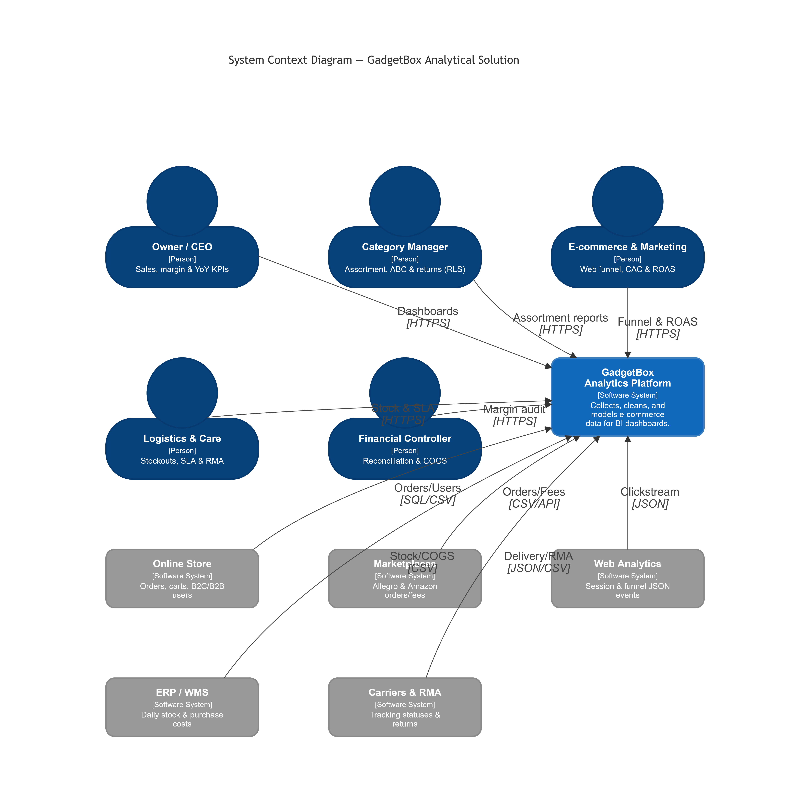
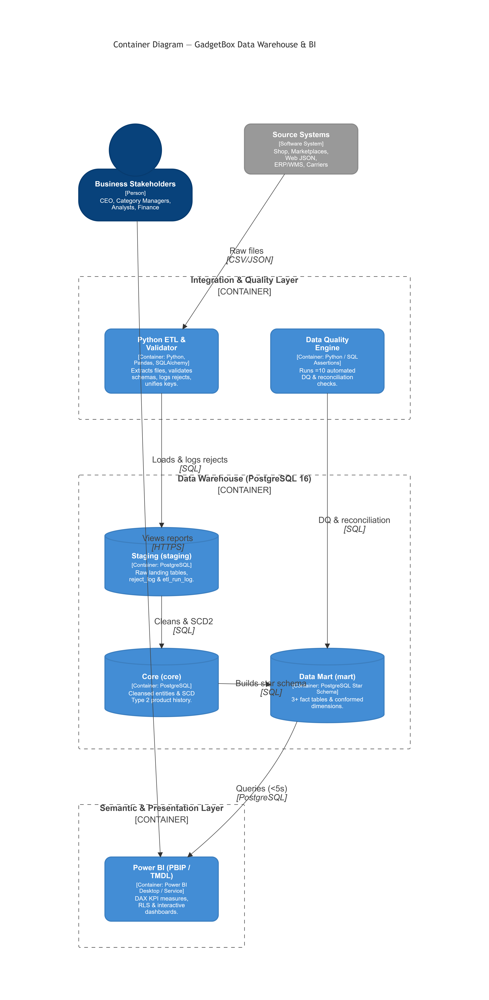

# C4 Architecture Diagrams — GadgetBox Analytics

This document describes the high-level system architecture of the GadgetBox analytical solution using the C4 model (Level 1: System Context and Level 2: Container).

## 1. Level 1: System Context Diagram

## 2. Level 2: Container Diagram

## 3. Architectural Layers Summary

| Layer | Technology | Responsibility |
|---|---|---|
| 1. Data Sources | CSV, JSON (Synthetic Generator) | Simulates Shop, Marketplaces, Web Events, ERP/WMS, Carriers, and RMA. |
| 2. Integration (ETL) | Python (Pandas, SQLAlchemy) | Extraction, schema validation, deduplication, SKU/Customer unification, reject logging. |
| 3. Storage Zones | PostgreSQL (`staging`, `core`, `mart`) | Isolates raw ingestion from cleansed historical data and analytical marts. |
| 4. Analytical Model | Dimensional Star Schema | 3+ Fact tables of distinct grain, 6+ Dimensions, SCD Type 2 on Product cost/price. |
| 5. Semantic & BI | Power BI (PBIP / TMDL text format) | Centralized DAX KPI definitions, RLS per category manager, interactive reports. |