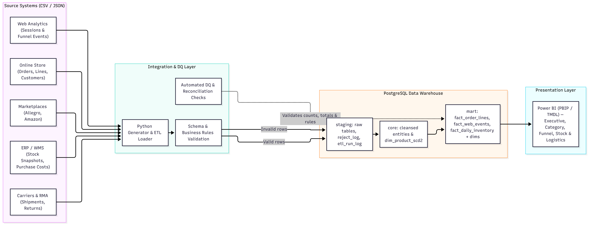

# Data Lineage — GadgetBox Analytics Platform

This document describes end-to-end data lineage from source systems through ingestion, transformation, dimensional modeling, and BI reporting.

## 1. End-to-End Flow Overview

## 2. Layer-by-Layer Lineage Mapping

| Source / Domain | Raw Format | `staging` | `core` | `mart` Target | BI / KPI Usage |
| --- | --- | --- | --- | --- | --- |
| Orders & Order Lines | CSV / JSON | `raw_orders`, `raw_order_lines`, `reject_log` | Cleansed orders, proportional discount allocation, unified keys | `fact_order_lines`, `dim_date`, `dim_customer`, `dim_channel` | Net sales, order count, AOV, gross margin, YoY & plan vs actual |
| Products & Purchase Costs | CSV | Raw product & cost exports | `dim_product_scd2` (`valid_from`, `valid_to`, `is_current`) | `dim_product_scd2` | Assortment & ABC reports, COGS valuation by order date |
| Web Clickstream | JSON | Raw event batches | Deduplicated session & funnel events | `fact_web_events`, `dim_date`, `dim_customer`, `dim_product_scd2` | Conversion rate, funnel stages, abandoned carts |
| Inventory Snapshots | CSV | Raw stock snapshots | Daily closing stock per SKU & warehouse | `fact_daily_inventory`, `dim_warehouse`, `dim_date`, `dim_product_scd2` | Stockout rate, days of stock, stock value |
| Carriers & RMA | JSON / CSV | Raw shipment & return records | Normalized delivery & return/complaint records | `fact_order_lines` / return & delivery attributes, `dim_carrier` | Return & complaint rate, delivery SLA & lead time |